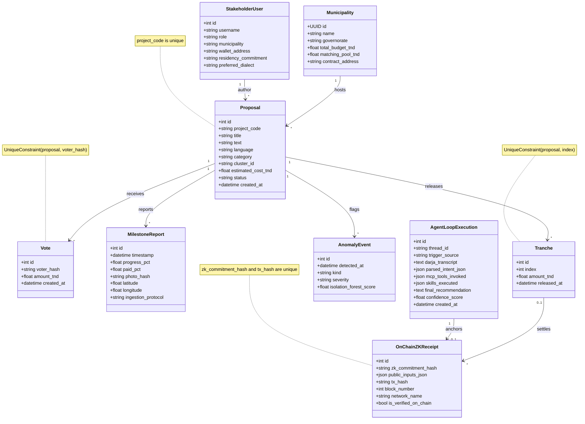
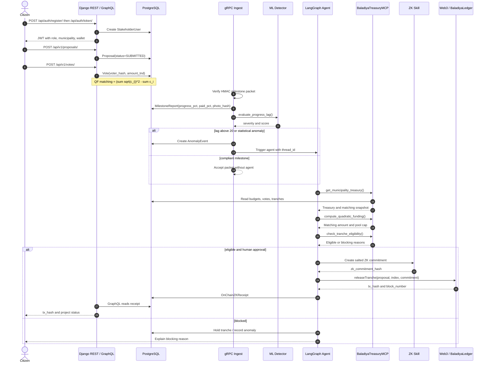

# Baladiya-Trust UML

## Class diagram

## Proposal-to-payout sequence

The Web3/ZK release is the target flow implemented in the blockchain week; REST, GraphQL, gRPC,
ML, MCP and the model relations above are already in the repository.
